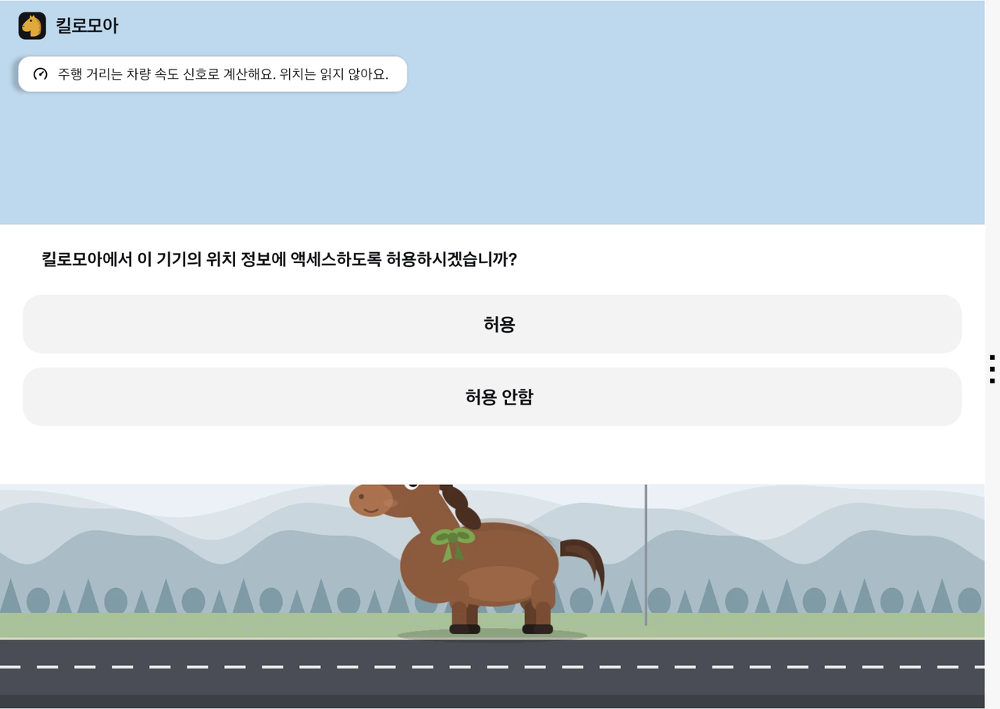
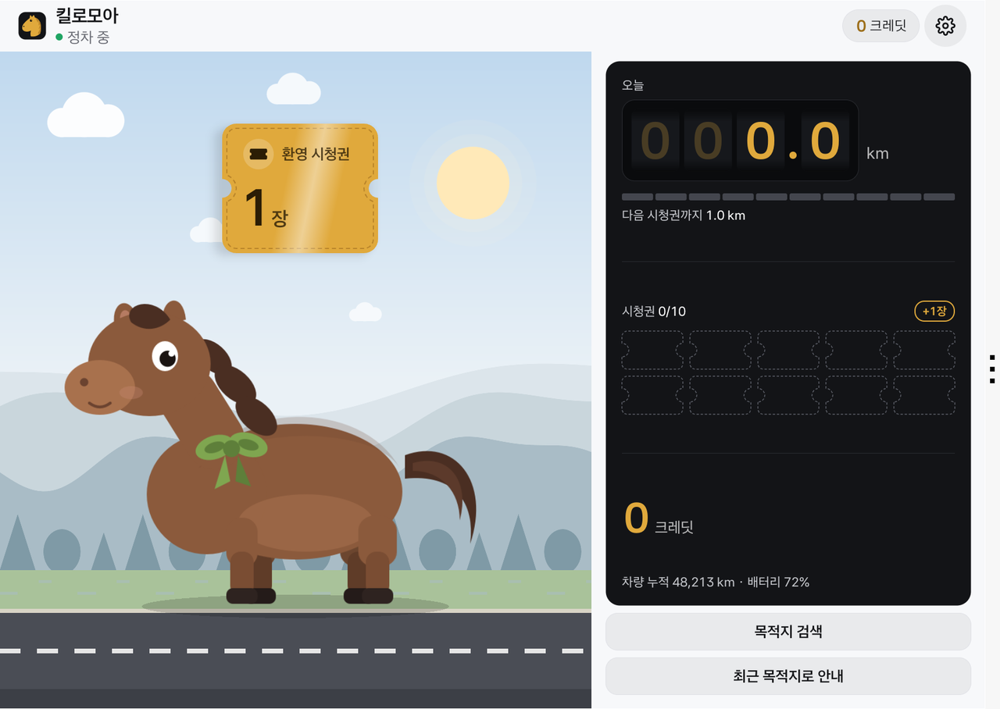
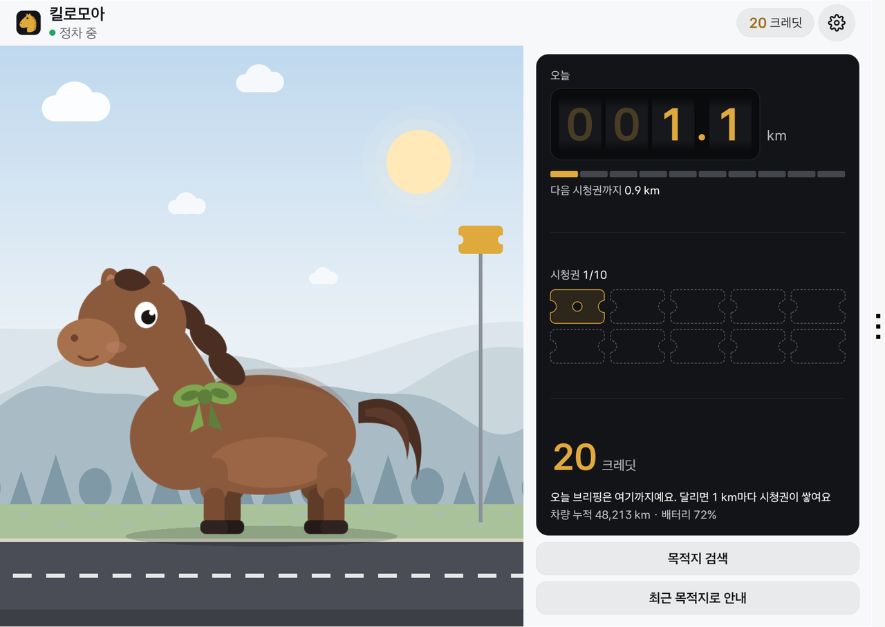
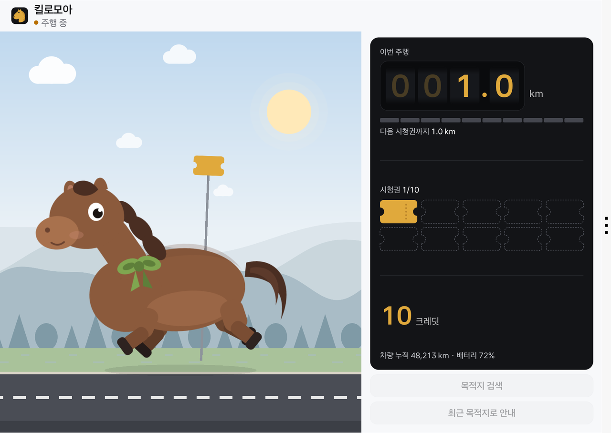
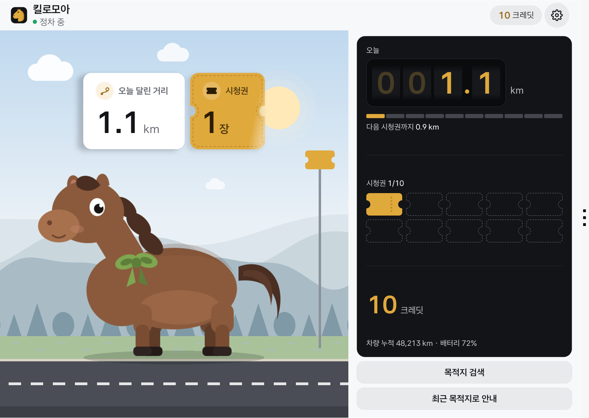
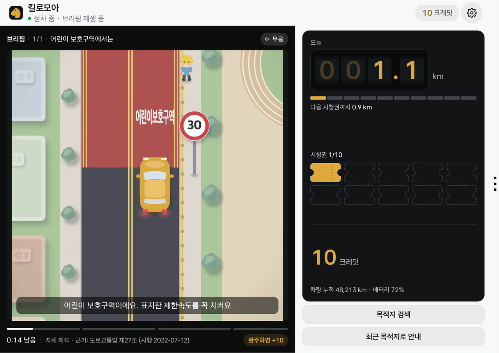
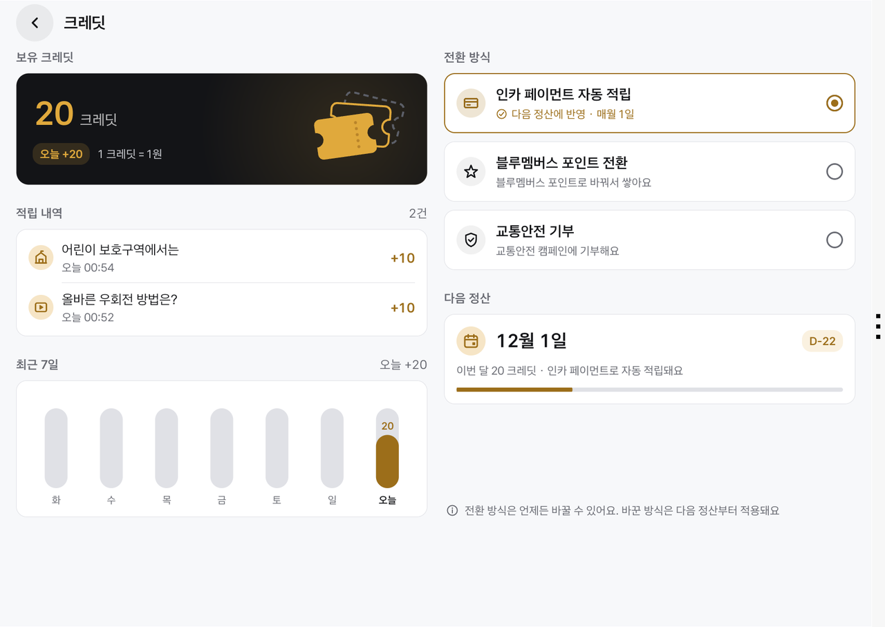
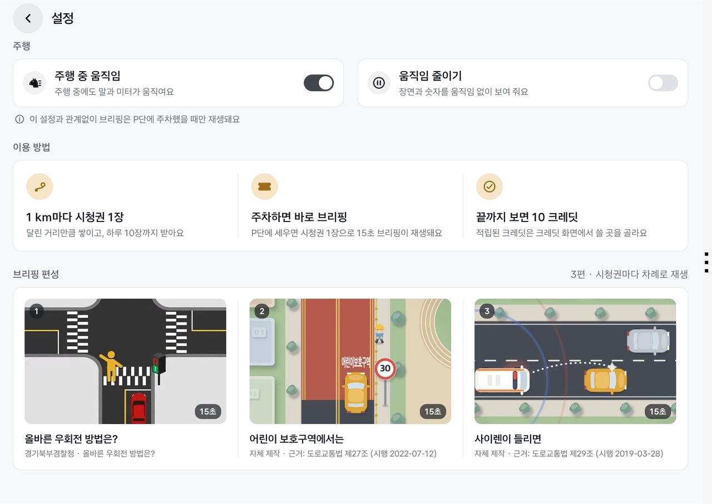
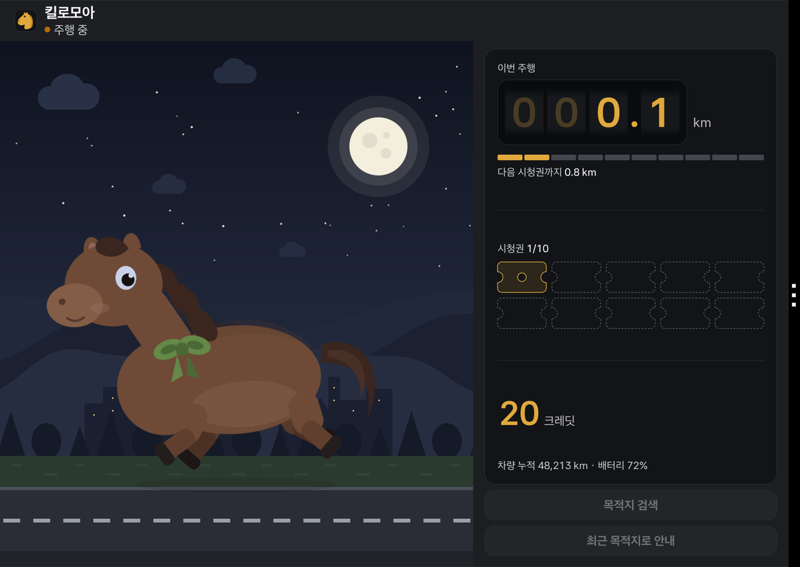

# 킬로모아

달린 만큼 시청권이 쌓이고, P단에 주차하면 15초 교통안전 브리핑이 자동으로 재생되어 크레딧이 쌓이는 Pleos Connect(현대차그룹 AAOS) 리워드 미터기 앱입니다.

| 첫 실행 | 환영 시청권 | 주차 |
|---|---|---|
|  |  |  |
| **주행: 1 km 이정표** | **도착 보상** | **P단 브리핑** |
|  |  |  |
| **크레딧** | **설정** | **밤** |
|  |  |  |

## 1. 핵심 루프

| 단계 | 차량 상태 | 앱 동작 |
|---|---|---|
| 주행 | 속도 > 0 | 장면이 움직이고(조랑말이 달리거나 광부가 곡괭이질을 합니다) 미터기가 돕니다. 1초 간격 속도 신호를 시간 적분한 거리 1 km마다 시청권 1장(하루 최대 10장). 초원 말 테마에서는 1 km마다 이정표가 조랑말을 지나가며 시청권이 미터로 날아듭니다. 영상은 없습니다. |
| 신호 대기 | D단, 0 km/h | 장면이 멈추고 숫자는 그대로입니다. 영상은 어떤 경우에도 없습니다. 시청권이 있으면 "주차하면 받을 수 있어요"를 보여 줍니다. |
| 주차 | P단, 0 km/h, UXR 영상 허용, 속도 권한 | 도착 보상(오늘 달린 거리 → 이번 주행 시청권) 뒤 브리핑이 자동 재생됩니다. 끝까지 보면 10 크레딧이 한 번 적립됩니다(사용자 확인 없음). |
| 재생 중 출발 | P에서 벗어남 | 즉시 멈추고 재생 위치를 저장합니다(1초 체크포인트). 다음 주차에서 그 위치부터 이어서 봅니다. 같은 시청권은 두 번 적립되지 않습니다. |
| 충전 보너스 | 주차 중 충전 포트 연결 확인 | 시청권 +1장(주차 세션당 1회, 하루 상한 안에서). 하늘에 "충전 보너스 1장" 티켓이 뜬 뒤 브리핑이 열립니다. 신호가 없거나 미지원이면 보너스 없이 그대로 동작합니다. |

새로 설치하면 환영 시청권 1장과 크레딧 0으로 시작합니다. 브리핑은 시청권마다 차례로 돕니다: 팀이 직접 만든 15초 교통안전 영상 "우회전, 먼저 멈춰요", "어린이 보호구역에서는", "사이렌이 들리면". 영상마다 근거 조문과 시행일을 플레이어 하단에 표시합니다.

## 2. 화면 구성

- **장면(Godot 4.7.2, 3D).** 테마마다 작은 클레이 디오라마입니다. 초원 말: 리깅된 조랑말이 주행 속도에 맞춰 걷고·속보하고·구보하며(60 km/h에서 최대) 초원 받침이 발 아래에서 돌고, 1 km마다 이정표가 조랑말 옆을 지나갑니다. 보석 광산: 광부가 수정 바위 옆에서 곡괭이질을 합니다. 꼬마 광부: 아이 광부 둘이 금빛 동전 아래 바위를 캡니다. 낮/황혼(16:30~18:30)/밤에 따라 배경색과 조명이 바뀝니다. 주차 중에는 캐릭터가 숨 쉬듯 서 있고, 신호 대기에서는 멈춥니다. 캐릭터와 받침은 팀이 그린 원화로 VARCO 3D에서 만든 모델입니다.
- **미터기.** 오늘(주차)·이번 주행(주행) 거리를 트립미터처럼 굴러가는 숫자로, 다음 시청권까지 남은 거리를 10칸 게이지로, 오늘 받은 시청권을 2줄 10장의 티켓(볼 수 있음·다 봄·아직)으로, 크레딧을 큰 숫자로 보여 줍니다. 크레딧이 오르면 카운트업과 함께 티켓 조각이 튀어 오릅니다.
- **브리핑 극장.** 장면 자리를 덮는 무음 플레이어입니다. 영상 위에 앱이 자막 한 줄을 그리고, 자막 구간으로 나뉜 진행 바, 남은 시간, 출처, "완주하면 +10"을 함께 보여 줍니다.
- **도착 보상.** 주차하면 하늘에 "오늘 달린 거리" 카드가 숫자를 세며 오르고, 앰버 티켓 "시청권 N장"이 도장처럼 찍힌 뒤 극장이 열립니다.
- **크레딧.** 보유 크레딧(오늘 적립분만큼 카운트업), 적립 내역(편별 시각), 최근 7일 막대, 전환 방식 3가지(인카 페이먼트 자동 적립, 블루멤버스 포인트 전환, 교통안전 기부), 다음 정산(매월 1일, D-day, 이번 달 적립과 전환 방식).
- **설정.** 주행 중 움직임(기본 켬), 움직임 줄이기, 테마(초원 말·보석 광산·꼬마 광부, P단에서 선택), 이용 방법, 브리핑 편성.
- **소개.** 상단 바의 "소개" 버튼이 "사용 기술" 페이지를 엽니다: 장면의 캐릭터를 VARCO 3D로 만든 과정(그림 → 3D 모델 → 뼈대 → 동작)과 VARCO 3D·VARCO Sound(효과음·배경음, 추후 예정) 사이트의 QR 코드, 개인정보 안내, 콘텐츠 문의 메일 QR. 앱은 브라우저를 열지 않고 QR만 보여 줍니다.
- **런처 아이콘.** 어두운 타일 위 앰버 말 머리(어댑티브 아이콘).

## 3. 안전 게이트

재생 허용 판정(`android/core/.../PlaybackSession.kt`의 `VehicleStatus.playbackAllowed`)은 아래 조건이 **모두** 참일 때만 열립니다. 하나라도 UNKNOWN이면 닫힙니다(fail-closed).

| 조건 | 값 | 출처 |
|---|---|---|
| 차량 서비스 연결 | `connected == true` | AAOS `Car` 연결 콜백 |
| 속도 권한 | `android.car.permission.CAR_SPEED` 허가됨 | 런타임 권한(4.3절) |
| 속도 | 정확히 `0.0` km/h(유한값) | `PERF_VEHICLE_SPEED` |
| 기어 | `STOPPED_PARKED`(P단)만. D단 0 km/h(`STOPPED_WAITING`)는 UXR 비트와 무관하게 거부 | `GEAR_SELECTION` |
| UXR 수신 | `activeRestrictions`와 `requiresDistractionOptimization`이 모두 수신됨 | `CarUxRestrictionsManager` |
| NO_VIDEO 비트 | `activeRestrictions & 0x10 == 0` | AAOS `UX_RESTRICTIONS_NO_VIDEO = 0x10` |

- 속도 0만으로는 절대 재생하지 않습니다. 메뉴(크레딧·설정)는 더 좁은 `parkedActionsAllowed`(P단이고 UXR 제한 0)에서만 열립니다.
- UXR이 권위입니다. 앱은 받은 비트를 지우지 않고, 플랫폼 정책(동영상은 Parking에서만 허용, Driving 금지)과 같은 방향으로 더 좁게 닫습니다. 정책 원문: https://document.pleos.ai/docs/pleos-only/vehicle-app-planning-guide/driving-restiction-policy
- 네이티브(Kotlin)가 안전·보상을 결정하고 Godot 장면은 렌더만 합니다. 장면은 호스트의 `set_safety_allowed(false)` 한 번으로 즉시 정지합니다(`godot/README.md`).
- 주행 중 화면에는 영상·텍스트 애니메이션·파티클이 없습니다. 장면의 움직임(조랑말의 달리기, 광부의 곡괭이질)과 미터의 짧은 움직임(주차 때의 절반 길이)은 설정 "주행 중 움직임"으로 끌 수 있고, 신호 대기에서는 멈춥니다. 재생 중 P단을 벗어나면 같은 프레임에 플레이어를 닫습니다.

## 4. 실행 방법

### 4.1 준비물

- Pleos Connect 에뮬레이터 **v2.1.0**(2026-10-19). Virtual Console이 포함되고 CRN 지원이 종료된 버전이므로 **CRN 주입 절차가 필요 없습니다.** 릴리스 노트: https://document.pleos.ai/en/docs/pleos-only/release-note/emulator-release-note
- Android SDK platform-tools(`adb`). 아래 명령은 에뮬레이터 시리얼이 `emulator-5556`인 경우입니다.
- APK: 6절의 GitHub Releases에서 받은 `KiloMoa_KiloMoa_release.apk`.

### 4.2 설치와 실행

```sh
adb -s emulator-5556 install -r KiloMoa_KiloMoa_release.apk
adb -s emulator-5556 shell am start -n ai.kilomoa.app/ai.cashdrive.app.home.PermissionGateActivity
```

앱은 런처에 "킬로모아"로 보입니다. 처음 열면 권한 안내 화면("주행 거리는 차량 속도 신호로 계산해요. 위치는 읽지 않아요.") 위에 속도 권한 다이얼로그가 뜨고, 허용하면 홈이 열리며 환영 시청권으로 첫 브리핑이 재생됩니다. 다이얼로그는 홈과 다른 태스크에서 띄웁니다. Pleos 런처가 태스크의 첫 최상단 액티비티를 기준으로 주행 중 차단 여부를 정하기 때문입니다(9절).

### 4.3 속도 권한이 "위치 정보 액세스"로 표시되는 이유

AAOS Car 서비스는 `android.car.permission.CAR_SPEED`를 `android:permissionGroup="android.permission-group.LOCATION"`, `protectionLevel="dangerous"`로 선언합니다(AOSP `packages/services/Car/service/AndroidManifest.xml`, android14-release: https://android.googlesource.com/platform/packages/services/Car/+/refs/heads/android14-release/service/AndroidManifest.xml ). 그래서 시스템 다이얼로그 제목이 위치 권한 그룹의 이름으로 나옵니다. 킬로모아는 위치 권한(`ACCESS_FINE_LOCATION` 등)을 선언하지 않고, 위치를 읽거나 저장하지 않으며, 이 권한으로 차량 속도만 읽습니다. 거부하면 상태가 UNKNOWN으로 남아 잠금 화면의 "권한 허용" 버튼으로 다시 요청할 수 있습니다.

다이얼로그 없이 허가하려면(심사 편의):

```sh
adb -s emulator-5556 shell pm grant --user current ai.kilomoa.app android.car.permission.CAR_SPEED
```

### 4.4 Virtual Console 조작: `tools/vconsole.sh`

에뮬레이터 2.1.0의 Virtual Console(기기 포트 8088)은 기어·속도·충전 상태 등을 바꿉니다. 웹 UI를 써도 되고, 이 저장소의 `tools/vconsole.sh`로 터미널에서 조작할 수도 있습니다(에뮬레이터 전용 도구이며 실차에 쓰지 않습니다).

```sh
tools/vconsole.sh hb-start            # 콘솔 하트비트 시작(쓰기에 필수)
tools/vconsole.sh gear Park|Reverse|Neutral|Drive
tools/vconsole.sh drive <kph>         # 속도 설정, 예: drive 60
tools/vconsole.sh stop                # 속도 0(브레이크)
tools/vconsole.sh charge on|off       # 충전 포트 열기 + 충전 스위치 켜기 / 반대
tools/vconsole.sh state               # 읽기 전용: 기어·속도·충전·하트비트·AAOS 주행 상태·UXR
tools/vconsole.sh catalog [domain]    # 읽기 전용: 콘솔 write endpoint 목록
tools/vconsole.sh hb-stop             # 하트비트 종료
```

알아둘 점 세 가지(스크립트 머리말에 근거가 있습니다).

1. **쓰기에는 하트비트가 필요합니다.** 콘솔은 브라우저 세션(3초 이내 POST)이 살아 있을 때만 PUT을 받습니다. `hb-start`가 그 역할을 하며, 없으면 `gear`·`drive`가 조용히 무시됩니다.
2. **마지막 기어가 유지됩니다.** 세션을 Drive로 끝내면 AAOS 주행 상태가 moving/idling에 머물러 앱이 계속 닫혀 있습니다. 항상 `gear Park`, `stop` 뒤에 `hb-stop` 하십시오.
3. **`charge on`은 `EV_CHARGE_PORT_OPEN`과 `EV_CHARGE_SWITCH`를 바꿉니다.** 앱은 `EV_CHARGE_PORT_CONNECTED`와 `EV_CHARGE_PORT_OPEN`을 함께 읽습니다.

Virtual Console이 없는 에뮬레이터(2.1.5, userdebug 이미지)에서는 `tools/vhal.sh`를 같은 하위 명령(`gear`, `drive`, `stop`, `charge`, `odo`, `state`)으로 씁니다. 에뮬레이터 차량 HAL의 디버그 인터페이스에 값을 쓰며 하트비트가 필요 없습니다. 2026-11-12 시연 영상은 이 방법으로 찍었습니다.

Odometer(주행거리) 카드는 콘솔 motion 도메인에 있고 1 km 단위로 수동 조작합니다. 적립은 속도 적분으로 계산하므로 Odometer 조작은 표시·교차 검증에만 쓰입니다(7절).

### 4.5 권장 시나리오(약 5분)

```sh
tools/vconsole.sh hb-start && tools/vconsole.sh gear Park && tools/vconsole.sh stop
# 앱 실행 → 권한 허용 → 환영 시청권 → 첫 브리핑 자동 재생 → 완주 "+10 크레딧"
tools/vconsole.sh gear Drive && tools/vconsole.sh drive 60     # 60 km/h: 1 km에 60초. 장면이 움직이고 미터가 돔, 영상 없음
tools/vconsole.sh stop                                         # D단 0 km/h: 장면 정지, 영상 없음, "주차하면 받을 수 있어요"
tools/vconsole.sh drive 60                                     # 1 km를 넘기면 이정표가 지나가고 시청권 +1
tools/vconsole.sh stop && tools/vconsole.sh gear Park          # 도착 보상 카드 → 브리핑 자동 재생
tools/vconsole.sh gear Drive                                   # 재생 중 출발: 즉시 멈춤, 위치 저장 토스트
tools/vconsole.sh gear Park                                    # 멈춘 위치부터 이어보기 → 완주 → 적립
tools/vconsole.sh charge on                                    # 충전 보너스 카드 → 브리핑
tools/vconsole.sh charge off && tools/vconsole.sh gear Park && tools/vconsole.sh hb-stop
```

앱을 강제 종료하고 다시 열어도 크레딧·시청권·재생 위치는 기기 내 원장(SQLite)에서 복구됩니다. 밤 화면은 `adb -s emulator-5556 shell cmd uimode night yes`로 볼 수 있습니다.

## 5. 테스트 환경과 테스트 명령

- 검증 환경: macOS(Apple Silicon, arm64) + Pleos Connect 에뮬레이터 v2.1.0(arm64 이미지, `emulator-5556`, 2560x1440, 160 dpi). APK는 `arm64-v8a`와 `x86_64`를 모두 포함합니다.
- 빌드 도구: JDK 17, AGP 8.7.3, Kotlin 2.0, compileSdk 34 / minSdk 28, Godot 4.7.2(gl_compatibility), Python 3(샌드박스 서버 테스트), ffmpeg(브리핑 영상 생성).

자동 테스트(2026-11-10 기준 결과):

```sh
# 도메인(순수 Kotlin): 재생 게이트, 멱등 원장, 이어보기, 속도 적분 미터기, 하루 상한, 충전 보너스
cd android && ./gradlew :core:test                          # 82건 통과
# 홈(JVM): 브리핑 편성·자막, 미터 계산, 보상 시퀀스, 크레딧 형식, 토스트, 장면 요청, 문구 검사
cd android && ./gradlew :app:testShowcaseDebugUnitTest      # 126건 통과

# Godot 렌더러 계약: 안전 잠금 즉시 정지, 잘못된 요청 fail-safe, 세 테마의 동작·프레이밍, 이정표·도착 동작
<Godot 4.7.2> --headless --path godot --import
<Godot 4.7.2> --headless --path godot --script res://tests/test_renderer.gd    # 109건 통과, 0 failure

# 루프백 샌드박스 서버(제출 빌드에는 포함되지 않음)
python3 -m unittest server.test_backend -v
```

에뮬레이터 시나리오는 4.5절과 같습니다. 화면 캡처·로그·측정 기록은 팀 작업 저장소에 보관합니다.

## 6. APK 위치

- 제출 APK: 서명된 `showcase` 플레이버 release입니다. 185 MiB로 GitHub 파일 한도(100 MiB)를 넘어 저장소의 `apk/` 대신 GitHub Releases에 올렸습니다: https://github.com/JongGakSeo/pleos-aaos-cash-drive/releases/tag/v0.1.0 (파일 `KiloMoa_KiloMoa_release.apk`, 표시 이름 `킬로모아_킬로모아_release.apk`).
- 빌드 출력 이름은 `android/app/build/outputs/apk/showcase/release/KiloMoa-showcase-release.apk`입니다. 서명 설정이 없으면 `-unsigned`가 붙은 설치 불가 파일이 나오므로 제출본과 혼동되지 않습니다.
- 패키지명 `ai.kilomoa.app`, 런처 액티비티 `ai.cashdrive.app.home.PermissionGateActivity`(속도 권한을 확인한 뒤 홈 `ai.cashdrive.app.home.HomeActivity`를 새 태스크로 엽니다).

## 7. Pleos SDK 사용 목록

Pleos Playground SDK와 AAOS Car API 사용 범위입니다. 모든 SDK 호출은 **읽기 전용**이며 `set*` 계열은 쓰지 않습니다. 모든 값은 null을 허용하고, 값이 없으면 해당 표시만 숨겨질 뿐 안전 게이트는 AAOS 신호만으로 판정합니다.

| 구성 | 버전 / 권한 | 쓰는 곳 | 비고 |
|---|---|---|---|
| Pleos Vehicle SDK, Odometer | `ai.pleos.playground:Vehicle:2.3.2`, `pleos.car.permission.CAR_DRIVE`(normal) | 미터 하단 "차량 누적 km" 표시, 속도 적분 거리와 교차 검증 로그 | 적립 소스는 속도 적분이며 두 값을 합산하지 않습니다. 양산 단계에서 Odometer 단조 증가분을 1순위로 전환합니다. |
| Pleos Vehicle SDK, EvBattery | 같은 AAR, `pleos.car.permission.CAR_ENERGY`(normal) | 배터리 SOC, 충전 포트 열림(충전 보너스 맥락) | AAOS `EV_CHARGE_PORT_CONNECTED/OPEN`과 함께 읽습니다. |
| Pleos NaviHelper | `ai.pleos.playground:NaviHelper:3.0.5`, `NAVI_ROUTE`·`NAVI_ROUTE_SEARCH`·`NAVI_CUSTOM_MAP`(normal) | 주차 중 "목적지 검색"·"최근 목적지로 안내", 주행 중 "도착까지 … 시청권 +n 예상" 힌트 | 도착 이벤트는 힌트 문구에만 쓰고 안전 게이트에는 쓰지 않습니다. |
| Gleo App Schema | `assets/schema.json`(`CHECK_REWARD_BALANCE`, `OPEN_KILOMOA`) | "오늘 얼마 벌었어", "킬로모아 열어줘" | Action 수신 → 응답 브로드캐스트(`APP_ACTION_RESPONSE`, 시스템 수신자에게만) |
| AAOS Car API | `android.car.permission.CAR_SPEED`(런타임), `CAR_POWERTRAIN`, `CAR_ENERGY_PORTS`(normal) | `PERF_VEHICLE_SPEED`(1 Hz), `GEAR_SELECTION`, `CarUxRestrictionsManager`, `EV_CHARGE_PORT_CONNECTED/OPEN` | 안전 게이트와 거리 적분의 유일한 소스 |

- AAOS 표준 API에서 주행거리 속성 `PERF_ODOMETER`는 `CAR_MILEAGE`(signature|privileged) 권한이라 일반 앱이 읽을 수 없습니다. 그래서 거리 측정은 공개 속성인 속도의 시간 적분을 기본으로 하고, Pleos Vehicle SDK Odometer로 교차 검증합니다.
- 쓰지 않는 SDK: TextToSpeech 3.3.1(브리핑은 무음, 플레이어에 "무음" 표기), FusedLocation, LLM SDK.

## 8. 서비스 구조

- **차량 신호.** 속도·기어·UXR·충전 포트를 AAOS 속성으로 실시간으로 받습니다. 제출 플레이버(`showcase`)는 `DEMO_SIGNALS=false`로 빌드되어 신호 주입 도구가 없고, 주입 호출은 실행 시 거부됩니다.
- **원장.** 시청권 발급, 시청 위치(1초 체크포인트), 완주 적립을 기기 내 원장(`cash_drive_playback_v2.db`)에 멱등으로 기록합니다. 같은 시청권은 한 번만 적립됩니다.
- **브리핑 편성.** 시청권마다 자체 제작 교통안전 영상 3편이 차례로 재생됩니다. 영상 파일에는 자막을 굽지 않고, 앱이 자막 큐를 그려 테마와 크기를 맞춥니다. 재생 중 P단을 벗어나면 멈추고 다음 주차에서 이어서 봅니다.
- **크레딧.** 1 크레딧 = 1원입니다. 매월 1일 정산되어 사용자가 고른 방식(인카 페이먼트 자동 적립, 블루멤버스 포인트 전환, 교통안전 기부)으로 전환됩니다. 전환 방식은 언제든 바꿀 수 있고 다음 정산부터 적용됩니다.
- **하루 상한과 보상 규칙.** 시청권은 하루 10장, 완주 1편에 10 크레딧, 충전 보너스는 주차 세션당 1장입니다. 속도·급가속과 무관하게 거리로만 쌓입니다.

## 9. 검증 상태

근거 칸의 `evidence/…`는 팀 작업 저장소에 있는 기록 폴더 이름입니다(캡처·로그·측정값, 이 저장소에는 넣지 않았습니다).

| 항목 | 상태 | 근거 |
|---|---|---|
| P 전용 게이트, 멱등 원장, 이어보기, 속도 적분, 하루 상한, 충전 보너스, Odometer 교차 검증 규칙 | 단위 테스트 통과 | 5절 `:core:test` |
| 브리핑 편성·자막·극장 진행, 미터 계산, 보상 시퀀스, 크레딧 형식, 제품 문구 검사 | 단위 테스트 통과 | 5절 `:app:testShowcaseDebugUnitTest` |
| Godot 장면 계약(안전 잠금 즉시 정지, 모션 fail-safe, 이정표·도착, 프레이밍) | 테스트 통과 | 5절 렌더러 테스트 |
| 첫 실행(권한 → 환영 시청권 → 첫 브리핑 → 완주 적립) → 주행 1 km(이정표·시청권) → 신호 대기 무영상 → 주차 보상 → 브리핑 → 크레딧·설정 → 야간 | 에뮬레이터 실신호로 확인 | `evidence/2026-11-09-overhaul/`, `screenshots/` |
| 재생 중 D단 전환 즉시 중단(0 km/h 포함), P 복귀 후 이어보기·적립 | 에뮬레이터에서 확인 | `evidence/2026-11-09-overhaul/` |
| 영상 파일이 없거나 깨졌을 때: 대체 카드로 바꾸고 15초 뒤 정상 적립 | 에뮬레이터에서 확인 | `evidence/2026-11-09-overhaul/fix-24*`, `fix-25*` |
| 충전 포트 신호 수신과 충전 보너스("충전 보너스 1장" 카드 → 브리핑) | 확인 | `evidence/2026-11-08-emulator/`, `evidence/2026-11-08-smoke/`, `evidence/2026-11-10-video/` |
| 시연 영상 87.7초: 첫 실행부터 야간까지 한 번에, 제출 APK와 같은 서명 release 빌드 | 에뮬레이터 2.1.5에서 차량 HAL 값으로 촬영, 전 구간 프레임 검수 | `evidence/2026-11-12-video/` |
| Pleos Vehicle SDK Odometer·EvBattery 콜백, NaviHelper 연결·목적지 정보 콜백 | 확인 | `evidence/2026-11-08-emulator/` 로그 `CashDrivePleos`·`CashDriveNavi` |
| Gleo Action 수신·응답 | 브로드캐스트 → 리시버 → 응답 확인 | `evidence/2026-11-08-smoke/` |
| Pleos 런처의 주행 중 차단 방지(권한 다이얼로그를 별도 태스크에서 띄움) | 허용·거부→재요청 두 흐름 모두 주행·신호 대기에서 차단 없음 | `evidence/2026-11-08-launcher-gate/` |
| 주행 중 자원(플랫폼 기준 CPU 5% 미만, RAM 400 MB 이하) | 3D 테마(2026-11-11, `evidence/2026-11-11-3d-themes/`): 에뮬레이터(4코어) 40 km/h 주행 중 `top` 36~46%(코어 1개 기준, 기기 전체의 약 9~12%), 주차 약 4%, PSS 167 MB. 2D 장면이던 때는 주행 중 8~11%였습니다 | 기준 문서 https://document.pleos.ai/docs/pleos-only/vehicle-app-planning-guide/performance-resource-mgmt |

## 10. 라이선스와 저작

- 브리핑 영상 3편(우회전 일시정지, 어린이 보호구역, 긴급자동차 양보)과 아이콘은 팀이 직접 그린 벡터 그림(SVG)과 코드로 만들었습니다. 장면의 3D 모델(조랑말, 광부, 아이 광부, 받침과 소품)은 팀의 원화를 NC AI의 VARCO 3D에 넣어 생성·리깅·동작 적용한 것입니다(`godot/assets/varco/README.md`). 브리핑 문구의 근거 조문과 시행일은 국가법령정보센터 원문으로 확인했습니다(문안·근거 기록과 영상 제작 기록은 팀 작업 저장소에 있습니다).
- 서드파티 라이브러리: Godot Engine 4.7.2(MIT), AndroidX, Pleos Playground SDK(Vehicle 2.3.2, NaviHelper 3.0.5; 공개 Maven `https://nexus-playground.pleos.ai/repository/maven-releases/`).
- 소스 라이선스: All rights reserved.

## 11. 개발자용

빌드 환경 변수: `JAVA_HOME`(JDK 17), `CASHDRIVE_TOOLS_ROOT`(Godot 4.7.2가 들어 있는 로컬 도구 폴더, 기본 `../.tools`), `ANDROID_HOME`.

```sh
cd android
./gradlew :core:test                                   # 도메인 테스트
./gradlew :app:assembleShowcaseDebug                   # 에뮬레이터용 디버그(홈 + Godot 포함)
./gradlew :app:assembleShowcaseRelease                 # 제출용. 아래 서명 변수 4개가 모두 있을 때만 서명됨
./gradlew :app:assembleDemoDebug :app:assembleEmuDebug # 개발용 플레이버
```

- 플레이버(`signal` 차원): `showcase`(제출, 실신호, Godot 포함, 기기 내 원장 세션 `LOCAL_MOCK` 명시 opt-in), `vehicle`(실신호, release 가능), `emu`(x86_64 에뮬레이터), `demo`(발표용 합성 신호, 테스트 도구 포함, `applicationId` 접미 `.demo`). release는 `vehicle`·`showcase`만 활성입니다.
- 서명은 환경 변수 `CASHDRIVE_KEYSTORE`, `CASHDRIVE_KEY_ALIAS`, `CASHDRIVE_STORE_PASSWORD`, `CASHDRIVE_KEY_PASSWORD`로만 주입합니다. 키스토어는 저장소 밖에 보관하고 커밋하지 않습니다. 디버그 서명을 release 대신 쓰지 않습니다.
- Godot 팩(`cash_drive.pck`)은 `exportGodotPack` 태스크가 `godot/`에서 내보내 debug·showcase 자산에 넣습니다. 렌더러 계약과 테스트는 `godot/README.md`, 샌드박스 서버 API는 `server/README.md`를 보십시오.
- 브리핑 영상은 `tools/video/`의 스크립트로 다시 만들 수 있습니다(`render_briefing.mjs`).
- 이 저장소에는 소스와 이 README(화면 9장은 `screenshots/`)만 둡니다. 설계·계획 문서, 에뮬레이터 증거, 브리핑 문안·근거 기록은 팀 작업 저장소에 둡니다. `.tools`는 로컬 설정이며 소스가 아닙니다. `android/app/build/outputs`의 APK는 빌드 산출물이며 추적하지 않습니다.
